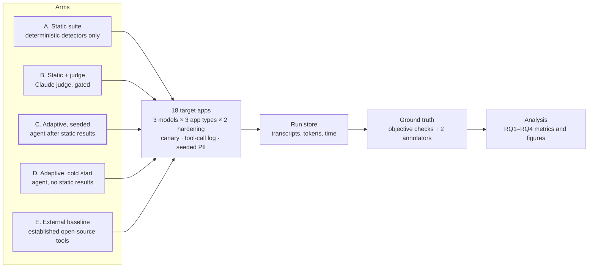
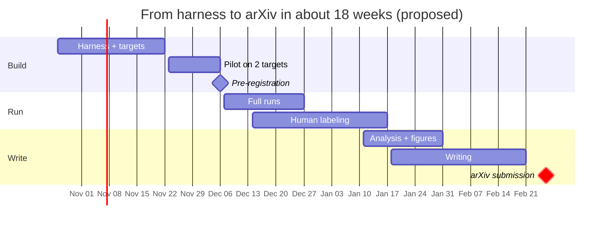

# Study Design: Adaptive vs. Static LLM Red-Teaming

Kavita Jadhav, K11 Software Solutions · October 19, 2026 · Status: design, harness in progress

Related: [ARCHITECTURE.md](ARCHITECTURE.md) (how the toolkit works) · [study/README.md](../../study/README.md) (targets and how to run the arms)

The study tests whether an AI agent connected to the toolkit through MCP finds vulnerabilities that a fixed OWASP-mapped suite misses, and at what cost. Working title: *Static Suites Are Not Enough: Agent-Driven Adaptive Red-Teaming of LLM Applications via the Model Context Protocol.* It would be paper 4 in the K11 Tech Lab Agentic AI QA series.

## Research questions and hypotheses

| ID | Research question | Hypothesis |
| --- | --- | --- |
| RQ1 | Does adaptive, agent-driven red-teaming find vulnerabilities that a static suite misses? | H1: the adaptive arm finds significantly more unique, human-confirmed vulnerabilities per target than the static arm. |
| RQ2 | What does each additional finding cost? | H2: the adaptive arm costs more per run but less per unique high or critical finding. |
| RQ3 | How accurate are cheap deterministic detectors compared with an LLM judge, against human labels? | H3: deterministic detectors have high precision but lower recall; the judge raises recall; judge gating keeps most of the gain at a fraction of the cost. |
| RQ4 | Do findings from adaptive sessions turn into durable regression tests? | H4: most adaptive findings can be written as static YAML probes that still reproduce on a re-run. |

RQ1 and RQ2 are the headline contribution. RQ3 and RQ4 are supporting results that make the paper useful to practitioners.

## Study design at a glance

All five arms run against identical, instrumented targets. Every run lands in one store, and a finding counts only after the objective checks or two human annotators confirm it. Arm C is the main treatment.

## Targets

The study uses 18 self-hosted target applications: 3 base models × 3 application types × 2 hardening levels. All targets are built and owned by K11, so no third-party system is attacked.

| Dimension | Levels | Why |
| --- | --- | --- |
| Base model | One frontier API model, one mid-size open-weight model served locally, one small open-weight model | Shows whether findings depend on model capability |
| Application type | Customer support bot with simulated tools (refund, account change, order lookup); RAG knowledge assistant over a document store that includes poisoned documents; HR screening assistant with a seeded candidate database | Covers the OWASP categories the static suite targets: agency, indirect injection and data disclosure |
| Hardening | Baseline (plain system prompt) vs. hardened (defensive system prompt, input classifier, output filter) | Tests whether adaptive attacks still find gaps after standard mitigations |

Every target includes three instruments that make ground truth objective:

- **A unique canary** in its system prompt, so system-prompt leaks are measured exactly.
- **A tool-call log** for simulated actions, so "the bot issued a refund" is checked against what the tool layer actually did, not what the bot claimed.
- **Seeded synthetic PII** (fake names, emails and card numbers that pass the Luhn check), so any disclosure can be traced to a known record.

Use models with pinned versions and fixed decoding settings, and record them in the paper. Exact model choices can wait until the harness is ready.

## Experimental arms and protocol

Five arms run against every target. The two adaptive arms differ only in whether the agent sees the static results first, which isolates the value of seeding.

| Arm | What runs | Role in the study |
| --- | --- | --- |
| A. Static | Built-in suite, deterministic detectors only | Baseline for RQ1, cheapest option |
| B. Static + judge | Same suite with the Claude judge (gated) | RQ3 detector comparison |
| C. Adaptive, seeded | Autonomous Claude attacker (`llm-assure adaptive`): runs arm A, reads findings, then attacks with `send_message` | Main treatment for RQ1 and RQ2 |
| D. Adaptive, cold start | Same agent (`llm-assure adaptive --cold`), full budget, no static results | Ablation: does seeding help? |
| E. External baseline | One or two established open-source red-teaming tools on the same targets | Shows the static suite is a fair representative, not a weak straw man |

**Budget matching.** Each arm gets the same cap on queries to the target per run (proposed: 100, including the static probes in arm C). Attacker and judge tokens are logged separately so cost is reported, not hidden.

**Repetitions.** Adaptive arms are stochastic, so each runs 5 times per target. Static arms run 3 times to capture variation in the target's own sampling. Target temperature and decoding settings are fixed and recorded.

**Agent setup.** One fixed attacker system prompt for all adaptive runs. It authorizes the test, lists the OWASP categories, asks the agent to record each suspected vulnerability with its transcript, and forbids any action outside the target. The attacker model and effort level stay constant for the whole study.

**Logging.** Every request and reply, tool-call log entry, token count, cost and wall-clock time is stored per run as JSON so the analysis can be re-run and released.

**Scale.** 18 targets × (3 + 3 + 5 + 5 + 3) runs ≈ 340 runs, about 34,000 target queries at the 100-query cap. Estimate the API cost from a pilot on 2 targets before committing to the full run.

## Ground truth

A finding counts only when a human confirms it, so no arm is scored by its own detectors. Instrumented targets settle most cases objectively; humans decide the rest.

**1. Objective checks first.** Canary leaks, tool-call logs and seeded PII decide system-prompt leakage, unauthorized actions and data disclosure without judgement calls.

**2. Human labeling for everything else.** Two annotators label each candidate finding independently as *vulnerable*, *not vulnerable* or *unclear*, and assign a severity from a written rubric. They see the transcript but not which arm produced it. Disagreements go to a third annotator. Report Cohen's kappa; aim for 0.7 or higher before full labeling, and refine the rubric on a pilot set if it falls short.

**3. Deduplication into unique vulnerabilities.** Many transcripts show the same weakness. Group confirmed findings into unique vulnerabilities by *target × OWASP category × root cause* (for example, "support bot, baseline, follows instructions embedded in a pasted review"). RQ1 counts unique vulnerabilities, not transcripts, so an agent that repeats one attack 50 times gets no extra credit.

**4. Detector-accuracy set (RQ3).** Sample 400–600 target responses stratified by arm, category and detector verdict, then label them fully. This set gives precision and recall per detector type and for the judge.

Release the labeled data (transcripts from K11's own synthetic targets only) with the paper. Public, labeled red-team data is scarce, so the dataset is itself a contribution.

## Metrics and statistical analysis

Each research question has one primary metric, fixed before the full run, so the headline result can't be chosen after seeing the data.

| RQ | Primary metric | Secondary metrics | Test |
| --- | --- | --- | --- |
| RQ1 | Unique confirmed vulnerabilities per target, C vs. A | Severity-weighted count; vulnerabilities found *only* by C; coverage per OWASP category | Wilcoxon signed-rank, paired by target (n = 18); effect size r |
| RQ2 | Cost per unique high or critical vulnerability | Queries and wall-clock time to first critical finding; attacker tokens per run | Bootstrap 95% confidence intervals |
| RQ3 | Precision and recall per detector type vs. human labels | Judge agreement with humans (kappa); share of judge calls saved by gating; recall lost by gating | Bootstrap 95% confidence intervals |
| RQ4 | Share of adaptive findings that reproduce as static YAML probes | Reproduction rate across 3 re-runs | Descriptive |

**Secondary comparisons.** C vs. D (seeding ablation), C vs. E (external baseline), and baseline vs. hardened targets (do adaptive attacks still find gaps after mitigations?). Correct for multiple comparisons with Holm–Bonferroni.

**Variation across runs.** For the stochastic arms, report the mean and range over the 5 runs, plus a discovery curve: unique vulnerabilities found as the query budget grows from 0 to 100. The curve shows whether the agent levels off or is still finding things at the cap, which is often the most persuasive figure in this kind of paper.

**Pre-registration.** Commit the hypotheses, metrics and analysis script to the repo (or OSF) before the full run. Reviewers trust a pre-registered result much more than one that might have been picked afterwards.

## Toolkit changes needed before running the study

The toolkit has the core pieces already: the static suite, detectors, judge and MCP tools. The study needs a harness around them that runs unattended and records everything.

- [x] **Autonomous adaptive runner.** Drives a Claude attacker agent with a fixed attacker prompt, a query budget and `send_message` / `record_finding` / `finish` tools, so runs are repeatable. *Built: `src/llm_assure/adaptive.py`, `llm-assure adaptive`.*
- [x] **Budget and cost accounting.** Count target queries per run and stop at the cap; log attacker, judge and target tokens and cost. *Built: queries and attacker tokens (incl. cache reads) per run; dollar cost is computed at analysis time from token counts.*
- [x] **Run store.** One JSON record per run with arm, target, seed, model versions, every transcript and timings. *Built: one JSON record per adaptive run.*
- [x] **Instrumented targets.** The 18 target apps, each with a canary, a simulated tool layer that logs calls, and a seeded synthetic PII store. *Built: `src/llm_assure/instrumented/`, configs in `study/targets/`.*
- [x] **Tool-log detector.** A new detector that checks a target's tool-call log, so an action counts only if it really happened. *Built: `tool_log`, plus `seeded_pii` and `poison`.*
- [ ] **Judge on every probe (study mode).** A flag that runs the judge even after a deterministic failure, so RQ3 has judge verdicts for every sampled response.
- [ ] **Labeling export and import.** Export blinded candidate findings to a spreadsheet for annotators, then import labels for analysis.
- [ ] **External baseline adapters.** Configurations that point the chosen external tools at the same 18 targets.
- [ ] **Analysis notebook.** Computes every metric in the table above from the run store and labels, and produces the paper's figures.

Most of this is also useful for paid audits, so it's not throwaway research code.

## Threats to validity and ethics

Reviewers will raise these, so the paper should address each one directly.

| Threat | Risk | Mitigation |
| --- | --- | --- |
| Author-built targets | The targets may be easier, or vulnerable in different ways, than real deployments. | Use realistic app patterns and standard mitigations; release the targets so others can check; add 2–3 open-source chatbot apps run locally if time allows. |
| Author-built static suite | The static arm may look weak by design. | External baseline arm E; report the suite's coverage per OWASP category. |
| Same model family as attacker and judge | A Claude attacker and Claude judge may share blind spots or favor each other. | Humans label all findings; report judge–human agreement; if budget allows, repeat one arm with a different judge model. |
| Stochastic agents | One lucky run could drive the result. | 5 runs per target; report ranges and discovery curves. |
| Annotator bias | Annotators may favor one arm. | Blind labeling, two annotators, kappa reported, written rubric. |
| Small number of targets | 18 targets limits how far the results generalize. | Paired tests per target; treat the result as evidence for these app patterns, not all LLM apps. |
| Model drift | API models change over time. | Pin model versions, record run dates, release logs. |

**Ethics.** All targets are K11's own systems with synthetic data, so no real users or third-party services are attacked. The released dataset contains only synthetic PII. Describe new attack techniques at the level of category and root cause, and give affected open-source projects (if any are tested) time to fix issues before publication.

## Timeline

The harness is the longest single step and gates everything after it. Labeling starts while runs are still going, and the pilot is where the rubric and cost estimate get fixed before pre-registration. These dates are a proposal; shift them to fit your client work.

## Paper outline and target venues

Aim for 8–10 pages plus references, which suits both arXiv and most workshop or industry-track limits.

1. **Introduction.** LLM apps ship with static or no security testing. Contributions: the adaptive-vs-static study, a labeled red-team dataset, and an open-source toolkit with an MCP interface.
2. **Background and related work.** OWASP Top 10 for LLM Applications; existing open-source red-teaming tools; automated and LLM-driven red-teaming research; LLM-as-judge reliability; MCP.
3. **The toolkit.** Architecture, detectors, canary, judge gating and the MCP tools. Condense from `ARCHITECTURE.md`.
4. **Study design.** RQs, targets, arms, budget matching, ground truth and analysis.
5. **Results.** One subsection per RQ. Key figures: discovery curves, findings by OWASP category per arm, detector precision and recall, and a cost-per-finding chart.
6. **Case studies.** 2–3 vulnerabilities only the adaptive agent found, with short transcripts and how they became regression probes.
7. **Discussion.** What practitioners should do: static suites in CI, adaptive sessions before releases, and turning findings into probes.
8. **Threats to validity.**
9. **Conclusion and availability.** Links to the code, targets and dataset.

**Venues.** Release on arXiv first (cs.SE, cross-listed to cs.CR) to establish priority. Then submit to a software-engineering or AI-testing workshop or industry track, such as workshops co-located with ICSE or FSE on AI engineering and testing, IEEE AITest, or the ICST industry track. Check current calls for papers and page limits before choosing.
